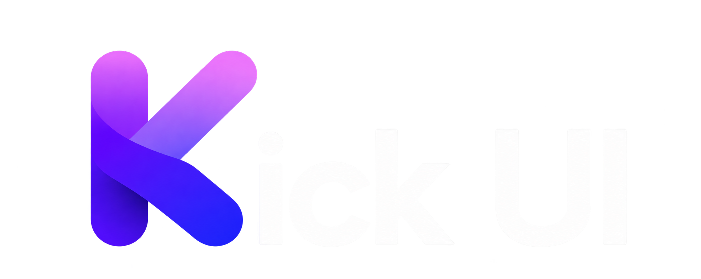

<div align="center">

<h1 align="center">
  
</h1>

**Animated React UI Components for Web3.**
Accessible · Customizable · Open Source — installed as source code you own.

[](./LICENSE)
[](https://ui.shadcn.com/docs/cli)
[](https://nextjs.org)
[](https://tailwindcss.com)

[Website](https://www.kickui.xyz) · [Documentation](https://www.kickui.xyz/docs) · [Component Catalog](https://www.kickui.xyz/components) · [Report Bug](https://github.com/Shivam-Prajapati-59/Kick-UI/issues)

</div>

---

## Install

One command per component — no package to install, you own the code:

```bash
npx shadcn@latest add https://www.kickui.xyz/r/pill-button.json
```

Or add Kick UI as a namespace once, then use short names everywhere:

```bash
npx shadcn@latest add @kick-ui/pill-button
```

```jsonc
// components.json
{
  "registries": {
    "@kick-ui": "https://www.kickui.xyz/r/{name}.json",
  },
}
```

Dependencies (npm packages and shadcn primitives) are resolved and installed automatically by the CLI.

## Components

| Category               | Components                                                                                           |
| ---------------------- | ---------------------------------------------------------------------------------------------------- |
| **Buttons**            | Pill Button, Slide Text Button                                                                       |
| **Cards**              | Card Stack, Pill Card, Stacked Carousel                                                              |
| **Components**         | Animated List, Deposit Modal, MagDock, Perspective Grid, Pixel Image, Timeframe Tabs, Venue Selector |
| **Text Animations**    | Scramble Text, Text Focus                                                                            |
| **Layouts & Sections** | Feature Showcase, Scroll Card                                                                        |
| **Animations**         | Cursor Web Fluid                                                                                     |
| **Charts**             | Trading Chart                                                                                        |

Browse live previews and copy-paste install commands at
[kickui.xyz/components](https://www.kickui.xyz/components).

## AI-ready with shadcn MCP

Kick UI is a shadcn-compatible registry, so it works with the official
[shadcn MCP server](https://ui.shadcn.com/docs/registry/mcp). Add the
`@kick-ui` registry to your project's `components.json` as shown above, then
configure the shadcn MCP server for your coding agent.

For example, with Codex add this to `~/.codex/config.toml`:

```toml
[mcp_servers.shadcn]
command = "npx"
args = ["shadcn@latest", "mcp"]
```

Restart your MCP client and ask it to search or install Kick UI components,
for example: _"Add @kick-ui/pill-button to my project."_

## Built with

React 19 · Next.js 16 · Tailwind CSS 4 · Motion · Radix UI · TypeScript (strict)

## Develop locally

```bash
bun install
bun dev          # docs site on localhost:3000
```

Useful checks:

```bash
bun lint         # ESLint
bun typecheck    # tsc --noEmit (strict)
bun run registry:check  # pipeline consistency, no writes
bun run test:unit       # pipeline unit tests (bun test)
bun registry:build && bun docs:build
```

See [CONTRIBUTING.md](./CONTRIBUTING.md) to add a component. Identity is
the filename: the registry name, doc filename, and demo filename must all
match, and the build pipeline validates everything else.

## License

Distributed under the [MIT License](./LICENSE).
